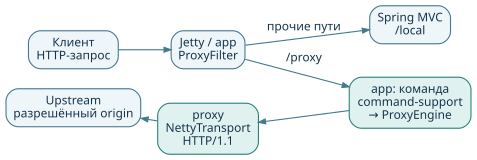
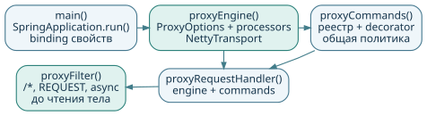
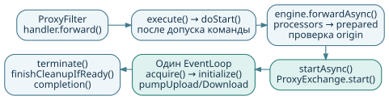
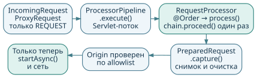
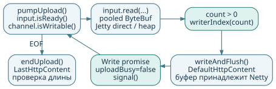
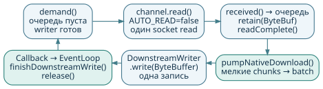
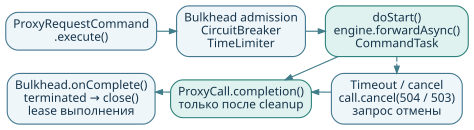
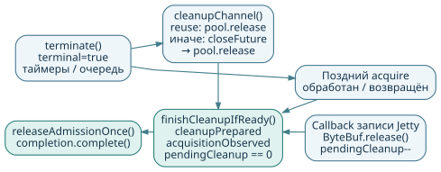

## Jetty + Netty

<a id="page-1"></a>

**Устройство и сопровождение основного потокового прокси NettyPet**

Руководство по связке `app` + `proxy` + `command-support`: как запускается
приложение, где принимается решение о маршруте, кто передаёт тело и когда
освобождаются ресурсы.

**Версия:** 24 октября 2026 · исходники `9ad9200` · Java 21 · Spring Boot 4.1.1 · Jetty 12.1.12 · Netty 4.2.19.Final.



Jetty принимает запрос через Servlet API. `ProxyFilter` выбирает маршрут,
ресурсная команда ограничивает выполнение, а `ProxyEngine` передаёт запрос
upstream по HTTP/1.1 через Netty. Тело остаётся непрозрачным потоком.

### Навигация

| Страницы | Содержание |
| --- | --- |
| [2–4](#page-2) | Модули, запуск и последовательность вызовов |
| [5–7](#page-5) | Процессоры, примеры заголовков/URI, пулы соединений |
| [8–10](#page-8) | Upload, download, буферы и Jetty I/O |
| [11–14](#page-11) | Команды, ошибки, завершение и настройки |
| [15–17](#page-15) | Запуск, проверки целостности и диагностика |

Другой вариант: [гайд Servlet + Jetty HttpClient](https://github.com/AlFlanker/NettyPet/blob/9ad92003a661d64ed49662cfc9b3b2a1c7132ce3/jetty-client-example/docs/jetty-client-guide.pdf).
Контракты двух реализаций различаются; здесь описана основная связка Jetty + Netty.

<!-- pagebreak -->

## Карта модулей и классов

<a id="page-2"></a>

Пути Java начинаются с `src/main/java/` соответствующего модуля.
Пакеты приложения — `dev.example.app`, транспорта — `dev.example.proxy`,
команд — `com.otr.portal.command`.

| Модуль / класс | Где находится ответственность |
| --- | --- |
| `app: ProxyApplication` | Точка входа Spring Boot |
| `app: config.ProxyConfiguration` | `ProxyEngine`, адаптер Jetty, регистрация фильтра |
| `app: config.ProxyProperties` | Binding `proxy`, преобразование `toOptions()` |
| `app: web.ProxyFilter` | Сопоставление `/proxy`, удаление префикса, выбор proxy/MVC |
| `app: command.ProxyRequestHandler` | Подписка на команду, HTTP-отказ до передачи владения |
| `app: command.ProxyRequestCommand` | Одноразовая ресурсная команда, `doStart()` и отмена |
| `app: config.ProxyCommandConfiguration` | Политика группы `proxy`, CircuitBreaker, timeout |
| `app: command.ProxyCommands` | Общая политика и доступ к диагностике лимитеров |
| `app: transport.JettyProxyIoAdapter` | Direct input и native downstream writer Jetty |
| `proxy: transport.ProxyEngine` | `forwardAsync()`: метаданные, процессоры, admission, async |
| `proxy: transport.NettyTransport` | EventLoops, DNS/TLS, пулы, общая остановка |
| `proxy: transport.ProxyExchange` | Один обмен: pumps, таймеры, буферы, cleanup |
| `proxy: transport.ProxyCall` | API `completion()` и `cancel(status)` |
| `proxy: api.*`, `core.*` | План/заголовки, процессоры, URI/origin, HTTP-правила |
| `command-support: AbstractResourceCommand`, `CommandResilienceDecorator` | Реактивный lifecycle, допуск, отмена и удержание ресурсов |

`app` связывает две независимые библиотеки. `proxy` не зависит от Spring Boot,
Jetty или библиотеки команд и не знает `/proxy`. `command-support` не знает
HTTP, Servlet и Netty. Контейнерные операции передаются через `ProxyIoAdapter`
и `DownstreamAborter`.

Конфигурация приложения — `app/src/main/resources/application.yml`.
Примеры расширения — `examples/ProxyCustomization.java`.

<!-- pagebreak -->

## Запуск и общие ресурсы

<a id="page-3"></a>



1. `ProxyApplication.main()` вызывает `SpringApplication.run()`.
   Spring связывает `ProxyProperties` и `ProxyCommandProperties`.
2. `ProxyConfiguration.proxyEngine()` преобразует свойства через `toOptions()`,
   получает `RequestProcessor` beans через `orderedStream()` и создаёт общий `ProxyEngine`.
   В конструктор передаются Jetty aborter и `JettyProxyIoAdapter.INSTANCE`.
3. `ProxyEngine` создаёт `ProcessorPipeline` и `NettyTransport`: EventLoops,
   resolver, TLS-контекст и admission. Пулы создаются лениво для `(Origin, EventLoop)`.
4. `ProxyCommandConfiguration.proxyCommands()` настраивает одну логическую группу
   `proxy`; `ProxyCommands` удерживает lease поколения политики реестра.
5. `proxyRequestHandler()` связывает transport с командами.
   `ProxyConfiguration.proxyFilter()` регистрирует фильтр на `/*`,
   только `DispatcherType.REQUEST`, с `asyncSupported=true`.

Порядок фильтра — `Ordered.HIGHEST_PRECEDENCE + 10`. Он должен перехватить
проксируемое тело до фильтров, которые его разбирают. При захвате маршрута
оставшаяся цепочка не вызывается. Локальные запросы продолжают обычный Spring MVC.

### Остановка beans

Bean `proxyCommands` объявлен с `@DependsOn("proxyEngine")`: при shutdown сначала
запрашивается отмена команд, затем останавливается transport. Оба beans имеют
`destroyMethod="close"`. Транспорт закрывает общую сетевую инфраструктуру;
поздние callbacks записи ещё должны вернуть принадлежащие им буферы.

Глобальная поддержка multipart/form/character encoding для MVC не отключена.
Для proxy тела не проходят через `@RequestBody`, message converters
или `StreamingResponseBody`.

Порт приложения — `8080`, bind address не задан; server compression выключена,
лимит headers `16KB`. `spring.jmx.enabled=true` создаёт локальный MBeanServer,
не удалённый JMX-коннектор или HTTP monitoring endpoint.

<!-- pagebreak -->

## Путь запроса и передача владения

<a id="page-4"></a>



`ProxyFilter.doFilter()` вычисляет raw path без context path. Точный `/proxy`
и `/proxy/…` направляются в `ProxyRequestHandler.forward()`. Остальные запросы
идут в `chain.doFilter()`: `/local` возвращает `local`, `/proxying` не проксируется.

При `server.servlet.context-path=/gateway` вход `/gateway/proxy/a?x=1&x=2`
передаётся как `/a?x=1&x=2`. Upstream base path добавляется отдельно.
`%XX`, повторные параметры и raw query не декодируются повторно.

### На исходном Servlet-потоке

`ProxyRequestHandler` создаёт команду и синхронно подписывается на `execute()`.
До возврата из фильтра транспорт должен либо вызвать `startAsync()`, либо
синхронно отказать. Reactor здесь не означает перенос подписки в другой scheduler.

После допуска `ProxyRequestCommand.doStart()` вызывает `ProxyEngine.forwardAsync()`:
проверки протокола → admission → `IncomingRequest`/`ProxyRequest` → процессоры →
`PreparedRequest.capture()` → проверка origin → `startAsync(request, response)` →
`ProxyExchange.start()`. Реальные wrappers request/response сохраняются.

### Передача на Netty EventLoop

На Servlet-потоке `ProxyExchange.start()` прикрепляет AsyncListener и ставит
`acquire()` в выбранный loop. На EventLoop выполняются `acquire()` →
`acquired()` → `initialize()` → отправка headers → pumps.
После handoff только transport завершает ответ: handler и fallback команды
больше не пишут в Servlet. Это предотвращает повторный error response после commit.

`ProxyCall` возвращается сразу. Его `completion()` означает окончание обмена
**и очистки**, а не получение первых заголовков. Не блокируйте его callbacks:
они могут выполняться на потоке I/O.

<!-- pagebreak -->

## RequestProcessor: до начала сети

<a id="page-5"></a>



`ProxyEngine.forwardAsync()` вызывает `ProcessorPipeline.execute(incoming, plan)`
синхронно на Servlet-потоке, **до `startAsync()` и создания Exchange**.
В `app` процессоры — Spring beans, порядок определяется `@Order`.

- `IncomingRequest` — неизменяемые method, raw path/query, headers и remote address.
  `firstHeader(name)` ищет без учёта регистра. Префикс приложения уже удалён.
- `ProxyRequest` — изменяемый план: `uri()` / `uri(URI)` и `headers()`.
  Тело и сетевые объекты в API не предоставляются.
- `chain.proceed()` вызывает остаток цепочки; это **ещё не отправка в сеть**.
  Продолжение вызывается ровно один раз, синхронно, на том же потоке.
- Для прикладного отказа выбрасывается `ProxyRejection`. Первый отказ сохраняется,
  даже если внешний processor перехватил исключение. `Error` не маскируется обычным отказом.

### Что происходит после цепочки

`PreparedRequest.capture()` создаёт неизменяемый snapshot итоговых URI и headers.
По одному URI выбираются pool, Host и request target. Последующая мутация сохранённого
плана не меняет запрос. `UpstreamUri.validate()` проверяет HTTP(S), host, порт,
отсутствие user info/fragment. Origin должен быть в allowlist, иначе `403`.

`HeaderRules` удаляет служебные и hop-by-hop поля; Host и framing задаёт transport.
`Headers` проверяет token имени и допустимость значения, включая CR/LF.
`add` сохраняет повторные значения, `set` заменяет, `remove` удаляет,
`get`/`first` читают, `asMap()` даёт снимок.

Здесь **нет response hook** и ограниченного `ProxyHeaderEditor` из другого примера.
Поля описания тела доступны редактору: изменение Content-Type/Encoding/Range
при непрозрачном теле требует корректного прикладного контракта.
Beans должны быть потокобезопасными; сеть, БД и чтение тела в processors запрещены.

<!-- pagebreak -->

## Пример расширения заголовков и URI

<a id="page-6"></a>

Создайте конфигурацию в пакете `dev.example.app`. Первый bean добавляет поля,
второй по исходному заголовку выбирает другой origin. Все действия выполняются
до сетевого обмена; `chain.proceed()` обязателен на успешном пути.

```java
package dev.example.app;

import dev.example.proxy.api.RequestProcessor;
import dev.example.proxy.core.UpstreamUri;
import java.net.URI;
import org.springframework.context.annotation.Bean;
import org.springframework.context.annotation.Configuration;
import org.springframework.core.annotation.Order;

@Configuration(proxyBeanMethods = false)
class GatewayProcessors {
    @Bean @Order(10)
    RequestProcessor serviceHeaders() {
        return (incoming, outgoing, chain) -> {
            outgoing.headers().set("X-Example-Service", "gateway");
            outgoing.headers().add("X-Example-Stage", "prepared");
            outgoing.headers().remove("X-Legacy-Header");
            chain.proceed();
        };
    }

    @Bean @Order(20)
    RequestProcessor alternateRoute() {
        return (incoming, outgoing, chain) -> {
            if ("alternate".equals(incoming.firstHeader("X-Route"))) {
                outgoing.uri(UpstreamUri.resolve(
                    URI.create("https://alternate.example/base"),
                    incoming.rawPath(), incoming.rawQuery()));
            }
            chain.proceed();
        };
    }
}
```

Для второго bean настройте `proxy.allowed-origins: ["https://alternate.example:443"]`.
Без разрешения новый origin даст `403`. Allowlist сравнивает scheme/host/port,
а не path или IP после DNS. Основной upstream origin разрешён автоматически.

Для отказа вместо `proceed()` можно выбросить
`new dev.example.proxy.api.ProxyRejection(403, "Route denied")`.
Сохранять plan/chain для поздней работы нельзя. Другие примеры — добавление полей
и замена raw path prefix — находятся в `examples/ProxyCustomization.java`.
Файл не входит в source sets; для подключения его копируют в пакет приложения.

<!-- pagebreak -->

## Netty: пулы, соединения и TLS

<a id="page-7"></a>

`NettyTransport` создаётся один раз на `ProxyEngine`.
`MultiThreadIoEventLoopGroup` содержит `proxy.io-threads` loops.
Exchange выбирает один loop через `nextLoop()` и остаётся на нём.
`pool(origin, loop)` лениво создаёт `FixedChannelPool` с ключом **(origin, loop)**.

| Уровень | Что ограничивает |
| --- | --- |
| `proxy-command.max-concurrent=128` | Ресурсные команды общей группы |
| `proxy.max-concurrent=256` | Принятые транспортом обмены, включая подготовку и cleanup |
| `connections-per-origin-per-loop=64` | Соединения в одном пуле |
| `pending-acquires-per-pool=64` | Очередь ожидания в одном пуле |

При двух loops теоретический предел соединений на origin — `2 × 64 = 128`.
Это не обещание равномерной загрузки: отдельный loop/pool может заполниться раньше.
Origin — схема, host и эффективный порт. Ни один лимит не означает число rps.

### Pipeline и управление чтением

`newPool()` настраивает pooled allocator, `AUTO_READ=false`,
`FixedRecvByteBufAllocator(chunkBytes)` и `maxMessagesPerRead(1)`.
Write watermarks — `chunkBytes` / `2 × chunkBytes`.
Pipeline: при HTTPS `SslHandler` → `HttpClientCodec` → `Inbound`.
Агрегатора полного тела и decompressor нет.

DNS resolver использует системные DNS-серверы и асинхронные Netty channels.
`connect-timeout` задаётся отдельно для TCP connect, TLS handshake и DNS query;
это не суммарный срок всех этапов. Общий бюджет задаёт Exchange.

TLS использует JDK provider, TLS 1.2/1.3, обычные доверенные CA и проверку hostname.
Redirect клиенту передаётся как ответ, автоматически не выполняется.
Cookies не накапливаются в общем store: передаются поля текущего обмена.
NTLM/Negotiate в итоговом Authorization отклоняются с `501`, поскольку такая
аутентификация привязана к соединению, а пул обслуживает разных клиентов.

Свободный канал закрывается после `idle-connection-timeout`. Активный обмен
этот параметр не ограничивает. Канал в состоянии закрытия не выдаётся повторно.

<!-- pagebreak -->

## Upload: ServletInputStream → Netty

<a id="page-8"></a>



`initialize()` выбирает I/O-режим, устанавливает `ReadListener` и отправляет
`DefaultHttpRequest`. После успешной записи headers сигналы запускают `pumpUpload()`.
Чтение допускается при `input.isReady()`, `channel.isWritable()` и отсутствии
`uploadBusy`; также проверяются terminal, EOF и ранний ответ upstream.

1. Выделяется один pooled `ByteBuf` размером `chunkBytes`.
   `JettyProxyIoAdapter` разрешает direct input только для точного класса `HttpInput`.
2. Native путь читает в `bytes.internalNioBuffer(...)` через `input.read(ByteBuffer)`.
   Это убирает промежуточный heap-массив и последующую heap → direct копию Netty NIO.
   Для другого input используется heap ByteBuf и его `byte[]`.
3. После чтения `bytes.writerIndex(count)` фиксирует число байтов.
   Длина сверяется с исходным Content-Length.
4. `channel.writeAndFlush(new DefaultHttpContent(bytes))` передаёт владение Netty.
   После передачи в pipeline буфер освобождает Netty, в том числе при ошибке записи.
   Пока write promise не завершён, следующий буфер не читается.
5. Write callback снимает `uploadBusy`, проверяет результат и вызывает `signal()`.
   При EOF `endUpload()` проверяет длину и отправляет `LastHttpContent`.
   После успешной записи конца тела запускается таймер финальных headers.

Здесь используются индексы ByteBuf; подготовка буфера отличается от
`position(0).limit(count)` в отдельном примере Jetty HttpClient.

### Что остаётся неизменным

JSON, multipart, form-data, бинарные и сжатые представления не разбираются.
Полное тело не собирается в памяти. HTTP chunked framing создаётся заново;
исходные границы HTTP chunks не являются частью обещания целостности payload.
Обратное давление не даёт читать всё клиентское тело, пока upstream медленный.

<!-- pagebreak -->

## Download: Netty → Servlet response

<a id="page-9"></a>



`NettyTransport.Inbound.channelRead()` вызывает `ProxyExchange.received(message)`
и освобождает исходное сообщение в `finally`. Для непустого тела Exchange сохраняет
собственную ссылку через `content.content().retain()` и помещает её в `responseQueue`.
Очередь полезных байтов ограничена `response-buffer-bytes`.

`signal()` объединяет события и планирует `runPump()` на закреплённом EventLoop.
Порядок внутри него: **`pumpDownload()` → `pumpUpload()` → `demand()`**.
Netty callbacks, Servlet readiness и завершение downstream записи будят один pump.

### Когда разрешено следующее чтение

`demand()` выдаёт `channel.read()`, если нет незавершённого read batch,
очередь пуста и, после финальных headers, downstream готов.
`channelReadComplete()` → `readComplete()` снимает `readPending` и подаёт сигнал.
Один socket read может породить много `HttpContent`, даже при `maxMessagesPerRead(1)`.
TLS и HTTP decoder также имеют свои внутренние буферы.

`received()` проверяет статус, transfer coding, bodyless ответы и финальность headers.
Промежуточные `1xx` ожидают финального ответа, `101` отклоняется.
Headers публикуются через `flushPending`, даже если первые байты тела задерживаются.

### Мелкие chunks без лишних записей

Native `pumpNativeDownload()` берёт уже накопленный префикс очереди:
как минимум два целиком помещающихся фрагмента, каждый **меньше 1024 байт**,
с суммой не больше `chunkBytes`. Они объединяются в один direct ByteBuf.
Крупные и одиночные фрагменты остаются исходными views.
Новых данных ради заполнения batch прокси не ждёт.

До возврата callback разрешена одна native downstream запись. Медленный клиент
останавливает следующие reads upstream. Размер ответа может быть 8 МиБ и больше:
лимит очереди не является лимитом полного тела.

<!-- pagebreak -->

## Jetty I/O и владение памятью

<a id="page-10"></a>

`JettyProxyIoAdapter.createWriter()` выбирает native writer только для точного
`ServletApiResponse`, пока output stream/writer не выбран. Wrappers не разворачиваются.
Для другого ответа transport использует переносимый Servlet-путь.

| Путь | Что происходит с данными |
| --- | --- |
| Native download | ByteBuffer view исходного ByteBuf передаётся в `ServletCoreResponse.write(false, …, callback)`; payload не копируется в Servlet scratch |
| Native batching | Уже доступные мелкие fragments копируются в один pooled direct ByteBuf |
| Portable download | Байты копируются в ленивый непулируемый `outputScratch`, затем в настоящий ServletOutputStream с проверкой readiness |
| Direct upload | Jetty читает сразу в ByteBuffer view pooled direct ByteBuf |
| Portable upload | Input читает в массив heap ByteBuf; NIO может дополнительно копировать его |

### Write callback — возврат памяти

При native записи `writingBuffer` удерживается, `writerBusy=true`,
`pendingCleanup` увеличивается. `downstreamWriteCompleted()` переносит завершение
в Netty loop. Только `finishDownstreamWrite()` освобождает ByteBuf и продолжает pump.
Callback не захватывает `servletGuard` под внутренней блокировкой Jetty.

Abort, AsyncListener.onComplete и возврат из `write()` не разрешают преждевременный
release. При остановленном loop поздняя очистка идёт через `GlobalEventExecutor`
без нового Servlet I/O. В portable пути исходный ByteBuf можно освободить после
копирования, но scratch нельзя изменять до следующей готовности output.

Native writer сообщает `flushesOnWrite()==true`: обычная запись уже публикует
порцию, отдельная пустая запись после каждого write не нужна. Для headers без тела
и буферизующих адаптеров explicit flush сохраняется.

### Что не входит в бюджет очереди

`response-buffer-bytes` считает queued payload, но не отдельную запись в полёте,
allocator capacity, метаданные, TLS, Jetty или socket buffers. RSS не вычисляется
умножением concurrency на chunk size. Callback доказывает возврат владения памятью,
а не получение байтов клиентским приложением. Сквозной zero-copy не обещается.

<!-- pagebreak -->

## Ресурсная команда и Resilience4j

<a id="page-11"></a>



`ProxyCommands.command()` создаёт одноразовый `ProxyRequestCommand`.
Подписка: `AbstractResourceCommand.execute()` → `CommandResilienceDecorator.executeTask()`
→ `CommandExecutor.executeScoped()` → допуск → `doStart()` и транспорт.
Политика общая для группы `proxy`.
`maxAttempts(1)` и `replayable(false)` исключают повтор уже прочитанного Servlet-тела.

| `proxy-command` | Default | Смысл |
| --- | --- | --- |
| `timeout` | `30s` | Срок ожидания команды; затем запрашивается отмена |
| `max-concurrent` | `128` | Bulkhead, включая очистку ресурсов |
| `failure-rate-threshold` | `50` | Процент ошибок для открытия CircuitBreaker |
| `sliding-window-size` | `20` | Последние вызовы, count-based окно |
| `minimum-number-of-calls` | `10` | Минимум вызовов до расчёта доли ошибок |
| `wait-duration-in-open-state` | `10s` | Ожидание перед пробным допуском |
| `permitted-calls-in-half-open-state` | `3` | Число пробных вызовов HALF_OPEN |

Это defaults **приложения**, а не общие defaults библиотеки команд.
Счётчики положительные, минимум вызовов ≤ размер окна, процент 1…100;
обе длительности — 1 мс…1 сутки. Автопереход OPEN → HALF_OPEN выключен:
после ожидания переход проверяется при следующем вызове.

### Timeout не равен окончанию cleanup

TimeLimiter может закончить ожидание подписчика раньше сетевой очистки.
`CommandTask.cancel(TIMEOUT)` вызывает `ProxyCall.cancel(504)`, иные причины — `503`.
Bulkhead permit сохраняется до task completion; его нельзя вернуть только по таймеру.

CircuitBreaker считает `UPSTREAM_FAILURE` и ответы upstream `5xx` ошибками.
Отмены, локальные недопуски и общий timeout не доказывают отказ upstream и исключены
из статистики через классификацию. HTTP `4xx` сам по себе не ошибка breaker.
Fallback возвращает ошибку, не подменяя уже начатое тело ответа.

<!-- pagebreak -->

## Ошибки, Expect и ранний ответ

<a id="page-12"></a>

| Сценарий | Локальное поведение до commit |
| --- | --- |
| CONNECT или входящий Upgrade | `501` |
| Expect, отличающийся от `100-continue` | `417` |
| Неподдерживаемый request transfer coding, NTLM/Negotiate | `501` |
| Некорректные исходные метаданные, mismatch длины upload | `400` |
| Финальный origin вне allowlist | `403` |
| Обычное исключение processor / подготовки | `500`, либо статус явного `ProxyRejection` |
| Admission/pool/Bulkhead заполнен, breaker открыт | `503` |
| Acquire timeout | `503` |
| TCP/TLS timeout, headers timeout, общий deadline | `504` по классификации соответствующего этапа |
| Иная ошибка соединения/протокола upstream, `101` | `502` |

Jetty отправляет interim `100` при первом выборе `getInputStream()` для запроса
с `Expect: 100-continue`; upstream этот Expect не пересылается.
Это отличается от отдельного Jetty HttpClient
примера, который отклоняет любой Expect. Неизвестные transfer codings не преобразуются.

### Ранний 401/413 во время upload

`received()` финальных headers ставит `uploadStopped`, запрещает keep-alive upstream
и добавляет downstream `Connection: close`. Новые чтения upload прекращаются,
ответ upstream продолжает передаваться. После полного ответа соединение upstream
закрывается как непереиспользуемое. В этой реализации нет Jetty `Request.fail()`.

### Ошибка после commit

До отправки headers transport может сформировать пустой error response.
После commit статус уже нельзя заменить: `DownstreamAborter` из `app` прерывает
Jetty Servlet channel. Обычное успешное завершение обрезанного тела создало бы ложный EOF.
`ProxyResult.status` — логический результат, он может отличаться от уже отправленного
клиенту статуса. Для причины завершения используйте `ProxyResult.outcome`.

Ошибки Servlet read/write и исчезновение клиента отменяют обмен и запускают cleanup.
Автоматического replay на другом соединении нет: потоковое POST/PUT тело невоспроизводимо.

<!-- pagebreak -->

## Completion, cancel и shutdown

<a id="page-13"></a>



`ProxyCall.cancel(status)` лишь ставит отмену в закреплённый EventLoop;
ожидания сети внутри нет. Статус должен быть 400…599. Повторная и поздняя отмена
не меняет завершённый обмен. Отмена CompletableFuture, полученного из представления
`completion()`, сама по себе не отменяет I/O.

`terminate()` переводит обмен в terminal, отменяет таймеры, освобождает очередь,
запускает возврат/закрытие канала и при соответствующем флаге вызывает `async.complete()`.
Прерывание Servlet response выполняют `fail()`/`servletIoFailed()`, до cleanup.
Буфер native записи остаётся жив до callback и учитывается в cleanup.

### Что ждёт finishCleanupIfReady()

```text
cleanupPrepared && acquisitionObserved
                && pendingCleanup == 0
                && !completion.isDone()
```

После барьера возвращается transport admission, записываются метрики и публикуется
`ProxyResult`. Ожидаемый acquire не отменяется вслепую: после timeout он ещё может
вернуть канал, который нужно обработать и освободить. До этого completion не готов.

Здоровый reusable канал возвращается в pool и остаётся открытым. Непригодный канал
сначала ждёт **локальный `Channel.closeFuture`**, затем возвращается в pool.
Неудачный pool release тоже требует закрытия. Это не подтверждение TCP ACK клиента
или завершения всех действий удалённой стороны; complete/abort Servlet — попытка финализации.

### Общая остановка

`ProxyCommands.close()` запрашивает отмену команд. Затем `ProxyEngine.close()` →
`NettyTransport.close()` закрывает admission, active exchanges, пулы и все channels,
включая занятые/подключающиеся, затем DNS resolver и loops. Закрытие одного pool
не заменяет закрытие всей группы channels. Поздний Jetty callback может закончить
per-call cleanup после остановки loops. Нельзя блокировать I/O callbacks ожиданием completion.

<!-- pagebreak -->

## application.yml: транспорт proxy

<a id="page-14"></a>

Файл `app/src/main/resources/application.yml`, префикс **`proxy`**.
`ProxyProperties.toOptions()` передаёт проверенные параметры библиотеке.
Свойства `example.proxy` относятся к другому приложению.

| Параметр | Default | Назначение |
| --- | --- | --- |
| `upstream` | `http://localhost:9000` | HTTP(S) base URI; переопределение `PROXY_UPSTREAM` |
| `io-threads` | `2` | Netty I/O loops для upstream |
| `max-concurrent` | `256` | Общий admission транспорта, включая подготовку и cleanup |
| `connections-per-origin-per-loop` | `64` | Соединения одного origin на один loop |
| `pending-acquires-per-pool` | `64` | Очередь одного pool |
| `chunk-bytes` | `65536` | Порция upload/receive/portable scratch; 1024…65536 |
| `response-buffer-bytes` | `262144` | Queued payload ответа; минимум `4 × chunk-bytes` |
| `connect-timeout` | `3s` | Отдельно TCP connect, TLS handshake и DNS query |
| `acquire-timeout` | `5s` | Ожидание свободного pool slot |
| `response-headers-timeout` | `10s` | Финальные headers после успешной отправки всего запроса |
| `exchange-timeout` | `60s` | Абсолютный async-бюджет; трафик его не продлевает |
| `idle-connection-timeout` | `30s` | Простой свободного канала в pool |
| `allowed-origins` | `[]` | До 32 дополнительных origin; основной разрешён всегда |

Числовые лимиты положительные; транспортные длительности — 1…2147483647 мс.
Upstream допускает base path, но не query/fragment/user info.
Origin сравнивается по scheme/host/port; это не проверка IP после DNS.

### Три разных бюджета

`proxy-command.timeout=30s` действует на ожидание команды и запрашивает отмену.
`proxy.exchange-timeout=60s` считает срок созданного Exchange, включая очередь loop
и получение канала; синхронные processors до его создания в этот срок не входят.
`response-headers-timeout=10s` начинается после успешной отправки конца запроса
и выключается на финальных headers. `1xx` ожидание не завершает.

<!-- pagebreak -->

## Сборка, запуск и HTTP-проверки

<a id="page-15"></a>

Из корня репозитория, JDK 21 и Gradle 8.14.3. В текущем checkout нет
`gradle/wrapper` JAR/properties; используйте установленный Gradle или облачный путь.

```bash
# Локально: NETTYPET_GRADLE=gradle
NETTYPET_GRADLE=/workspace/.setup/gradle
"$NETTYPET_GRADLE" :app:test :proxy:test :command-support:test :app:bootJar
PROXY_UPSTREAM=http://127.0.0.1:9000 \
  java -jar app/build/libs/app-1.0.0.jar
# В другом терминале:
curl -i 'http://127.0.0.1:8080/local'
curl --path-as-is -i \
  'http://127.0.0.1:8080/proxy/a%20b?x=%2F&x=2'
```

Последний запрос требует соответствующего upstream-маршрута; его 404 передаётся.
Для GET fixture в отдельном терминале:

```bash
python3 stress/get/server.py --host 127.0.0.1 --port 9000 \
  --size-mb 8 --backend-url http://127.0.0.1:9000
```

Для обычной multipart-формы замените файл и маршрут реальными значениями:

```bash
curl --http1.1 -F 'file=@payload.bin' -F 'description=sample' \
  'http://127.0.0.1:8080/proxy/upload'
curl --http1.1 -X PUT -H 'Transfer-Encoding: chunked' \
  --data-binary @payload.bin 'http://127.0.0.1:8080/proxy/upload'
```

### Проверка multipart по независимому эталону

```bash
# Один раз, новый каталог; терминал 1: foreground upstream.
python3 stress/multipart/prepare.py \
  --output /tmp/nettypet-multipart --size-mib 8
python3 stress/multipart/server.py \
  --manifest /tmp/nettypet-multipart/manifest.json --port 9001
# Терминал 2: запустите app с PROXY_UPSTREAM=http://127.0.0.1:9001
# Терминал 3:
python3 stress/multipart/smoke.py --data-dir /tmp/nettypet-multipart \
  --base-url http://127.0.0.1:8080/proxy/multipart
```

Приёмник проверяет размер, SHA-256 всего wire-тела и каждой части, boundary и
Content-Type. Smoke содержит негативные проверки порчи. Fixture требует Content-Length;
chunked upload проверяется отдельно. Один HTTP 200 не доказывает целостность.

<!-- pagebreak -->

## Нагрузка и проверка корректности

<a id="page-16"></a>

JMeter 5.6.3 отправляет готовое multipart body без дополнительной обёртки.
Assertions проверяют каждый POST/PUT по независимому manifest.
Нужны JDK 21 и новые JTL/log пути для каждого прогона.

```bash
# Облачные пути; локально используйте JDK 21 и установленный jmeter.
export JAVA_HOME=/workspace/.setup/tools/jdk-21.0.9+10
NETTYPET_JMETER=/workspace/.setup/tools/apache-jmeter-5.6.3/bin/jmeter
"$NETTYPET_JMETER" -n -t stress/multipart/multipart-post-put.jmx \
  -Jhost=127.0.0.1 -Jport=8080 -Jpath=/proxy/multipart \
  -JdataDir=/tmp/nettypet-multipart -Jthreads=2 -Jramp=0 -Jloops=2 \
  -l /tmp/multipart-netty.jtl -j /tmp/multipart-netty.log
python3 stress/multipart/check_results.py /tmp/multipart-netty.jtl
```

### Сохранённые проверки исходников

В основной связке **245 тестов**: `app` 74, `proxy` 87, `command-support` 84.
Полный сохранённый build — **285**, включая 40 отдельного Jetty HttpClient примера;
failures/errors/skips — 0. Это результаты проверки кода, не новый прогон при сборке PDF.

| Где | Что проверяется |
| --- | --- |
| `app/src/test` | Маршруты, Jetty direct I/O, byte integrity, commands, reset и shutdown |
| `proxy/src/test` | URI/headers, processors, framing, backpressure, pool/close, wrappers и cleanup |
| `command-support/src/test` | Допуск, отмена, timeout, retries для допустимых задач, resource lifecycle |
| `stress/get`, `stress/multipart` | Большой ответ и fixture с независимыми hash тела/частей |

### Как читать результаты GET

Для GET запустите fixture на `9000` и приложение с этим upstream, затем:

```bash
python3 stress/get/run.py --url http://127.0.0.1:8080/proxy \
  --reference-url http://127.0.0.1:9000/ --jmeter "$NETTYPET_JMETER" \
  --threads 20 --ramp 2 --duration 25 --output /tmp/get-netty-1
```

`stress/get/run.py` сверяет размер каждого ответа, SHA-256 — до и после нагрузки.
Исходный JMX ограничен **300 rps**, этот timer сохраняется wrapper; название
«500 rps» не является действующей настройкой. Fixture близок к 8 МиБ, не обязательно ровно 8 МиБ.

В отдельном сравнении двух приложений (4 CPU, 20 клиентов, HTTP/1.1, 64 КиБ,
прогрев, два 15-секундных прогона на вариант A/B/B/A) основной Netty дал
165,4 rps / 7,86 мс CPU на запрос; Jetty HttpClient — 190,1 / 5,59.
В экспериментальной копии JMX лимит 300 rps был удалён.
Основное приложение содержит commands/Resilience4j; это не чистое сравнение транспортов.
Условия, SHA и сырые значения — `jetty-client-example/performance-results.json`.

<!-- pagebreak -->

## Диагностика и развитие

<a id="page-17"></a>

| Симптом | Что проверить |
| --- | --- |
| 502 при рабочем `/local` | Upstream напрямую, порт/base path, DNS, TLS trust и hostname |
| 403 после смены URI | Итоговый origin и `allowed-origins`, включая scheme/port |
| 500 после processor | Исключение, header validation, ровно один синхронный `proceed()` |
| 503 | Bulkhead, transport admission, очередь конкретного pool, acquire timeout, состояние breaker |
| 504 | Какой срок истёк: command, exchange, connect/TLS или final headers |
| Permit занят после отмены | Незавершённый acquire, write callback, pool release или closeFuture |
| Искажённое тело | Фильтры, прочитавшие input; неверный multipart fixture; изменение representation headers |
| События задерживаются | `curl -N`, буферизация клиента/промежуточных прокси; batching не ждёт заполнения |
| Низкий rps | CPU/сеть всех узлов, прогрев, SHA JAR, JMeter timer, число операций на байт |

`ProxyEngine.metrics()` возвращает `ProxyMetrics.Snapshot`: счётчики admission,
rejection, completion, cancellation, 5xx, bytes, duration и peak queue.
Категории не образуют разбиение: admitted может затем попасть в rejected;
completed включает отменённые обмены. `activeRequests()` берётся из admission,
а не вычитанием накопительных метрик. Снимок при параллельных updates не атомарен целиком.

### При изменении поведения

- Обычный request header/маршрут: `RequestProcessor`, `@Order`, проверка итогового
  snapshot и allowlist. Response hook в этом API отсутствует.
- Body transformation: заново определить framing, Content-Length/Encoding/Range,
  backpressure и владение памятью; проверить большие/мелкие/медленные/отменённые тела.
- Новый контейнер: предоставить `DownstreamAborter` и при необходимости `ProxyIoAdapter`;
  корректность wrappers и callback ownership проверить отдельно.
- Аутентификация: поставить применимую проверку до перехватывающего фильтра.
  После захвата `/proxy` остаток filter chain не выполняется. Security сейчас нет.

Поддерживаются HTTP/1.1 upstream и непрозрачные тела. Нет CONNECT, WebSocket,
автоматических redirects/retries и обещания передачи trailers/промежуточных ответов downstream.
SSE ограничен абсолютными сроками. Переход на другую транспортную библиотеку
должен сохранять контракты команды, отмены и cleanup, если они нужны приложению.

Исходники: [NettyPet, версия 9ad9200](https://github.com/AlFlanker/NettyPet/tree/9ad92003a661d64ed49662cfc9b3b2a1c7132ce3).
Пересборка PDF: `python3 docs/jetty-netty/build_guide.py`.
