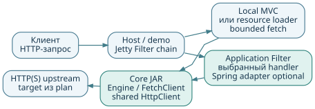
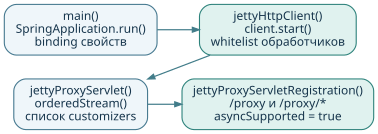
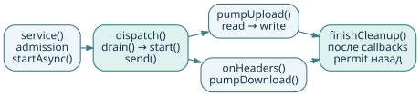
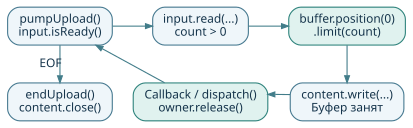
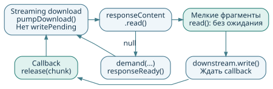
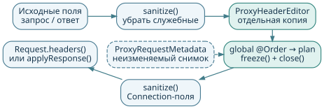
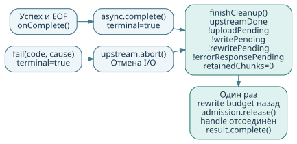

## Servlet + Jetty HttpClient

<a id="page-1"></a>

**Библиотеки `jetty-proxy`, Spring adapter и подключение к host**

Практическое руководство по исходникам NettyPet: границы library/demo,
порядок вызовов, тела, прикладные политики и ограниченный resource loader.

**Редакция:** 26 октября 2026 · runtime `65a1f9e` · Java 21 · Boot 4.1.1 · Jetty 12.1.12.



Host Filter выбирает handler до чтения тела. Core engine передаёт HTTP/1.1 поток,
bounded fetch обслуживает отдельный loader. Spring adapter включается явно;
маршруты и server settings находятся только в приложениях. Security и toggle не добавлены.

### Как читать

| Страницы | Содержание |
| --- | --- |
| [2–4](#page-2) | Карта исходников, запуск beans, путь одного запроса |
| [5–7](#page-5) | Upload, download, потоки и владение памятью |
| [8–9](#page-8) | Конвейер заголовков и пример расширения |
| [10–12](#page-10) | Ошибки, отмена, shutdown и конфигурация |
| [13–15](#page-13) | Запуск, проверка целостности, диагностика |

История первоначального примера: [PR #6](https://github.com/AlFlanker/NettyPet/pull/6).
Перенос: `MIGRATION.md`; текущие проверки: `jetty-proxy/IMPLEMENTATION.md`.
Исходный портал недоступен; host-пример проверяет подключение, не весь портал.
Редактируемая версия руководства и команда пересборки PDF находятся рядом с этим файлом в `docs/`.

<!-- pagebreak -->
## Карта исходников: что искать

<a id="page-2"></a>

Пути отсчитываются от корня репозитория. Public package сохранён:
`dev.example.jettyclient.proxy`. Core и Spring — обычные JAR без main/settings.

| Файл / класс | Роль и основные точки входа |
| --- | --- |
| Core: `JettyProxyClientFactory`, `ProxyTlsProfile` | Started client, одна TLS identity, trust/hostname проверки. |
| `JettyProxyProperties` | Plain options, `defaults()` без Spring binding. |
| `JettyProxyEngine`, `JettyProxyServlet` | Streaming Exchange; необязательный Servlet adapter. |
| `ProxyRequestPlan`, `ProxyExchangeExecutor` | Target, deadline, header/body/error policies; handoff. |
| `ProxyCall`, `ProxyExchangeResult` | Отмена и completion после cleanup; handle отсоединяет Exchange. |
| `ProxyHeaderEditor`, `ProxyHeaderPatch` | Быстрые hooks и immutable patch асинхронной стадии. |
| `ProxyErrorPolicy`, `ProxyErrorResponse` | Bounded local error до commit. |
| `policies/LinkRewritePolicy`, `HeaderRewriteCustomizer` | Общие URL/header/HTML rules без Netty ByteBuf. |
| `ProxyFetchClient`, Request/Result/Options | Отдельный bounded GET, decode и строковый loader. |
| `Downstream`, `ResponseContentBuffer` | Native/portable I/O, demand и batching. |
| Spring: `JettyProxyClientConfiguration` | Явный Import, qualified client/engine/fetch, binding. |
| `JettyProxyFilter` | Generic adapter; регистрации и URL library не создаёт. |
| Demo: `JettyProxyConfiguration` | Standalone `/proxy` и local MVC. |
| Host: `HttpProxyFilter`, handlers, loader | Выбор старого/нового transport и отдельная загрузка. |

### Настройки и доказательства поведения

- `jetty-proxy` и `jetty-proxy-spring` — library source/test и Maven metadata.
- `jetty-client-example` — demo; `jetty-proxy-integration-example` — отдельный host-proof.
- README библиотек, `MIGRATION.md` и `IMPLEMENTATION.md` — APIs, подключение и проверки.

Core не зависит от Spring/Netty. Только host-пример подключает старый `proxy`
для второй реальной ветки. Library не переносит закрытые application services.

<!-- pagebreak -->
## Запуск: от main до Filter {#запуск-от-main-до-готового-servlet}

<a id="page-3"></a>



1. Host явно импортирует `JettyProxyClientConfiguration`; component scan library
   не активирует её. Boot main и server settings находятся в host/demo.
2. `JettyProxySpringProperties` связывает `jetty.proxy` и создаёт plain core options.
   Qualified beans не используют посторонний HttpClient приложения.
3. `JettyProxyClientFactory` применяет typed TLS profile и запускает shared client;
   затем очищает декодеры и protocol handlers.
   Это делается **после** start: Jetty устанавливает стандартные обработчики при запуске.
4. В whitelist возвращаются `ContinueProtocolHandler`, `ProcessingProtocolHandler`,
   `EarlyHintsProtocolHandler` и `InformationalProtocolHandler`. Они позволяют
   дождаться финального ответа после промежуточных `100/102/103` и остальных `1xx`.
5. Engine получает ordered hooks, admission/timer/rewrite workers. Отдельный
   `ProxyFetchClient` делит client, но имеет собственные capacity/decode workers.
6. Только приложение регистрирует Filter/Servlet. Demo выбирает `/proxy`,
   host использует свой HttpProxyFilter и handler; library URL не устанавливает.

### Что настроено в клиенте

Redirect выключен, cookie store пустой, автоматическая распаковка и автоматическая
аутентификация/upgrade отключены. Отсутствующие `User-Agent` и `Content-Type`
не подставляются. Заголовки `Cookie` и повторные `Set-Cookie` текущего обмена
передаются, но cookies не хранятся между пользователями.

HTTPS проверяет сертификат и hostname. `ProxyTlsProfile` задаёт раздельные trust/key
stores, alias и TLS 1.2/1.3 до start. Key store не заменяет system trust.
Разные identities требуют отдельных clients.
Spring закрывает engine/fetch, затем client; Filter им не владеет. Без Spring
client создаётся той же фабрикой, а lifecycle управляет приложение.

<!-- pagebreak -->
## Один запрос: порядок вызовов

<a id="page-4"></a>



### Исходный Servlet-поток

Application Filter выполняет local/maintenance/backend/forbidden проверки,
выбирает один handler. Generic `JettyProxyFilter` использует planner: `null`
продолжает chain, plan передаётся executor. `forward()`
проверяет HTTP, target и async; stop, admission или отсутствие client executor дают `503`.
Фиксируются request metadata, длина тела и исходные application response headers.
Ошибка прикладного accessor даёт `500`, owned async завершается; body ещё не читается.

Engine вызывает `startAsync(request, response)`, сохраняя wrappers; адаптер может
передать уже начатый async той же пары объектов. Exchange попадает в реестр.
`attachLifecycle()` устанавливает listener и `async.setTimeout(0)` до возврата
из исходного dispatch. Поздний worker не вызывает `forward()` после его возврата.
Deadline контролирует engine; чужой async он не завершает.

### Сериализованный владелец Exchange

`dispatch(exchange::start)` ставит событие в очередь. В `start()` вычисляется
оставшийся срок, планируется deadline; optional request header stage возвращает
patch. Затем выполняются обычные hooks, patch и sanitize. Локальный отказ
заканчивается до upstream I/O; иначе создаётся Request с исходным регистром метода.
Если тело известно по длине или framing, подключаются `StreamingContent`
и `ReadListener`. `Request.send(this)` запускает обмен, `pumpUpload()` — чтение тела.

`onHeaders()` ожидает optional response stage до commit и demand. Callbacks
передаются тому же владельцу. Успех или `fail()` завершают async, а
`finishCleanup()` отдельно ждёт возврата ресурсов перед освобождением admission.

### Пример маршрутизации

В demo upstream `/base` плюс `/proxy/a?x=1&x=2` даёт `/base/a?x=1&x=2`;
host отдельно использует `/backend`. Library получает готовый trusted target.
Принятый контейнером raw path/query сохраняет `%XX` без двойного кодирования.
Неоднозначный URI контейнер может отклонить ещё до Filter.

<!-- pagebreak -->
## Upload: браузер → upstream

<a id="page-5"></a>



`ReadListener.onDataAvailable()` и `onAllDataRead()` вызывают
`dispatch(pumpUpload)`. Насос проверяет состояние обмена, `input.isReady()`
и отсутствие `uploadPending`. В полёте находится максимум одна upload-порция.

1. Из `ByteBufferPool` берётся буфер. Для точного класса Jetty `HttpInput`
   используется direct `ByteBuffer` и `read(ByteBuffer)`; для другого класса input —
   heap-массив и переносимый `read(byte[], …)`.
2. Размер чтения ограничен `chunkBytes`, даже если pool вернул большую ёмкость.
   После положительного чтения выставляются **`position(0).limit(count)`**.
   Здесь нельзя механически заменить подготовку буфера на `flip()`:
   поведение конкретного Jetty и стандартного Servlet API отличается.
3. `StreamingContent.write(buffer, callback)` отдаёт порцию клиенту upstream.
   Пока callback не сработал, буфер нельзя менять или возвращать pool.
4. Callback освобождает `owner` и снимает `uploadPending`. Успешный callback
   продолжает pump; ошибочный вызывает `fail(502)`, если обмен ещё активен и upload
   не остановлен ранним ответом. `once()` защищает от повторного завершения.
5. EOF приводит к `endUpload()`: проверке объявленной длины и `content.close()`.
   Избыток или недобор относительно Content-Length обрабатывается как `400`.

EOF продюсера ещё не означает успешную отправку: отдельный `requestSucceeded`
устанавливается только callback `onRequestSuccess()` клиента.

### Почему большие тела не требуют большой сборки

`StreamingContent` наследует `AsyncRequestContent`, а `getLength()` сохраняет
известную длину либо `-1` для неизвестной. Прокси не собирает тело полностью,
не разбирает JSON/multipart и не меняет сжатые байты. Отсутствующий Content-Type
остаётся отсутствующим. Границы HTTP chunked формируются заново на каждом соединении.

Это обратное давление: следующая порция upload не читается до подтверждения
предыдущей. Подтверждение возвращает владение памятью; оно не доказывает,
что удалённое приложение уже обработало эти байты.

<!-- pagebreak -->
## Download: upstream → браузер

<a id="page-6"></a>



`onHeaders()` снимает snapshot, ожидает optional response header stage и вызывает
hooks. Обычный streaming затем устанавливает статус и headers.
Явно выбранный body rewrite задерживает их до готовности output (стр. 7).
`onContentSource()` передаёт `Content.Source` в `ResponseContentBuffer`.
`pumpDownload()` работает по модели **read / demand**, без callback на каждый HTTP chunk.

- `read()` вернул `null`: регистрируется один demand; callback через `dispatch()`
  вызывает `responseReady()` и следующую попытку чтения.
- Получен chunk: `Downstream.write()` начинает запись. Его callback освобождает
  chunk, снимает `writePending` и продолжает pump. Дополнительный `retain()` не нужен:
  `Content.Source.read()` уже передал chunk вызывающему.
- Заголовки готовы, а тело задерживается: `Downstream.flush()` публикует их сразу.
  Только точный `HEAD`, а также 204/205/304, не имеют тела; `head` — другой метод.

Transfer-Encoding в metadata ответов HEAD/304 допустим и удаляется при forwarding.
Для 205 объявленная Content-Length больше нуля отклоняется до commit.
Link policy просит identity, только если клиент его допускает. При `identity;q=0`
сохраняются negotiation и passthrough; outbound compressor библиотека не добавляет.

### Объединение мелких фрагментов

Helper объединяет только уже доступные фрагменты **меньше 1024 байт**:
не больше `chunkBytes` и максимум 1024 просмотренных фрагмента за проход.
Одиночный доступный маленький chunk отправляется сразу. Новые данные ради
заполнения batch не ожидаются. Крупные chunks передаются без копирования для batch;
возможен один отложенный chunk (`carry`).

### Два способа записи

Native путь выбирается только для исходного Jetty `ServletApiResponse`, пока output
не выбран: `ServletCoreResponse.write(false, buffer, callback)`. Wrappers не обходятся.
Portable путь использует настоящий `ServletOutputStream`, `WriteListener` и собственный
непулируемый массив. `firstError` фиксирует в том числе reentrant `onError()` до
постановки события; pump повторно проверяет ошибку вокруг I/O и readiness.
Копии остаются; callback возвращает память, но не подтверждает TCP delivery.

<!-- pagebreak -->
## Потоки, владение и пределы памяти

<a id="page-7"></a>

`Exchange.dispatch()` принимает события из Servlet callbacks, HttpClient callbacks
и scheduler. Очередь и счётчик работы запускают `drain()`, который выполняет
действия одного обмена последовательно. События разных обменов могут идти параллельно.
Это не отдельный поток на запрос и не привязка к одному физическому потоку.

Обычно `drain()` работает в executor `HttpClient`; при rejection используется
commonPool. `Closeable DrainTask` переносит drain туда и когда executor принял job,
но отбросил его при stop; CAS допускает только один запуск. Inline drain под сетевыми
блокировками Jetty не выполняется. `servletGuard` защищает Servlet и переход
в недоступное состояние. `containerFinished()` запрещает I/O до постановки завершения.

| Ресурс | Кто владеет / когда освобождает |
| --- | --- |
| Admission permit | Exchange; только один `finishCleanup()` после всех условий |
| Upload pool buffer | Callback `AsyncRequestContent.write()`; до него повторное чтение запрещено |
| Chunk из `Content.Source.read()` | Сначала helper/Exchange, после передачи — callback downstream write |
| Aggregate мелких chunks | Одна pool reference; возвращённый chunk освобождается после write callback |
| Carry | Helper; отдаёт при следующем read или освобождает при отмене |
| Portable scratch | Downstream; не переиспользуется до readiness, после cancel отбрасывается |
| Header editor | Только текущий hook-поток; закрывается после конвейера |

### Практический смысл ограничений

Upload удерживает одну порцию, streaming download — одну запись; batching
ограничивает aggregate и lookahead. RSS включает также parser, pool, TLS,
wrappers и сокеты; формула `maxConcurrent × chunkBytes` не даёт его предел.

Opt-in body policy собирает bounded direct slabs, максимум 65 536 сегментов.
Два rewrite workers и очередь ограничены. Queued task при отмене удаляется;
running worker удерживает borrowed slices до возврата и output writes.
Java-код нельзя принудительно остановить. Для UTF-8/single-byte URL rewrite
неизменённые части остаются срезами; другие charsets имеют bounded String fallback.

Fetch — отдельный полный ответ: defaults 8 concurrent / 2 decoder workers / 8 queue,
не streaming semaphore. Wire, decoded и text budgets различаются; heap может
содержать массивы и String одновременно. Не переносите streaming concurrency128
на buffered loads без расчёта памяти. Лимиты body не равны точному пределу RSS.

Для storage I/O есть async header stages: worker возвращает immutable patch,
а не editor/Servlet. Быстрые callbacks не блокируют владельца.
Range/encoded/bodyless/no-transform обходят rewrite; новую длину и validators
контролирует engine. Без policy тело не накапливается.

<!-- pagebreak -->
## Заголовки: порядок и границы расширения

<a id="page-8"></a>



`ProxyHeaders.request()` запускает request hooks до отправки upstream.
`ProxyHeaders.response()` запускает response hooks для финального ответа
**до установки статуса и полей downstream**. Без global/per-plan hooks редактор не создаётся.

В обоих направлениях порядок одинаков: исходные поля очищаются, создаётся
отдельный `ProxyHeaderEditor`, global hooks идут по `@Order`, затем per-plan
hooks и optional stage patch. Результат очищается и применяется; editor закрывается.
Каждый hook вызывается один раз, если обработка дошла до соответствующей фазы.
После request hooks и очистки `prepareForwarding()` проверяет итоговый Authorization:
NTLM/Negotiate дают локальный `501`, включая поля, добавленные расширением.

`ProxyRequestMetadata` содержит `method`, готовый upstream `target` и глубокий
неизменяемый снимок исходных headers. Ключи `headers()` — в нижнем регистре;
`headerValues(name)` ищет без учёта регистра. Response hook получает тот же
исходный снимок, а не изменённые request hook поля. Async stage получает только
metadata и возвращает `ProxyHeaderPatch`; его factory быстрая, I/O — на app executor.

| Операция редактора | Поведение |
| --- | --- |
| `set(name, value)` | Заменить все значения этого имени |
| `add(name, value)` | Добавить значение, сохранив предыдущие |
| `remove(name)` | Удалить все значения без учёта регистра |
| `values(name)` | Получить неизменяемый снимок текущих значений |

### Что защищено

Нельзя менять `Host`, `Content-Length`, `Expect`, hop-by-hop поля и описание
непрозрачного тела: `Content-Type`, `Content-Encoding`, `Content-Range`.
Поля, перечисленные исходным `Connection`, удаляются и после hooks.
Повторные `Set-Cookie` и `Vary` дополняют поля предыдущих Filters: cookies и
CORS cache dimensions сохраняются. `Cache-Control` делится с учётом quoted values.

При потенциальном rewrite HEAD/304 не публикуют исходные длину и validators.
Для GET/HEAD без исходящего Range удаляются не-wildcard `If-None-Match` и
`If-Modified-Since`; wildcard и write preconditions сохраняются.

Неверное имя, CR/LF, управляющие или не представимые в ISO-8859-1 символы значения,
защищённая мутация, Exception/AssertionError/LinkageError из hook дают `500` до commit.
API не даёт менять URI, статус, тело или lifecycle. Beans общие для всех обменов:
их состояние должно быть потокобезопасным; сеть, БД и чтение тела в hooks исключены.

<!-- pagebreak -->
## Как добавить новый заголовок

<a id="page-9"></a>

В host после явного Import library создайте Spring-конфигурацию. Ниже полный
пример: первый bean ставит service header, второй использует его значение.
Порядок одинаков для запроса и ответа.

```java
package dev.example.jettyclient;

import dev.example.jettyclient.proxy.ProxyHeaderCustomizer;
import dev.example.jettyclient.proxy.ProxyHeaderEditor;
import dev.example.jettyclient.proxy.ProxyRequestMetadata;
import org.springframework.context.annotation.Bean;
import org.springframework.context.annotation.Configuration;
import org.springframework.core.annotation.Order;

@Configuration(proxyBeanMethods = false)
class ExampleHeaders {
    @Bean @Order(10)
    ProxyHeaderCustomizer service() {
        return new ProxyHeaderCustomizer() {
            public void customizeRequest(ProxyRequestMetadata r,
                                         ProxyHeaderEditor h) {
                h.set("X-Example-Service", "gateway");
            }
            public void customizeResponse(ProxyRequestMetadata r,
                                          int status, ProxyHeaderEditor h) {
                h.add("X-Example-Service", "gateway");
            }
        };
    }

    @Bean @Order(20)
    ProxyHeaderCustomizer stage() {
        return new ProxyHeaderCustomizer() {
            public void customizeRequest(ProxyRequestMetadata r,
                                         ProxyHeaderEditor h) {
                if (h.values("X-Example-Service").contains("gateway"))
                    h.add("X-Example-Stage", "after-service");
            }
            public void customizeResponse(ProxyRequestMetadata r,
                                          int status, ProxyHeaderEditor h) {
                h.set("X-Example-Upstream-Status", "" + status);
            }
        };
    }
}
```

Для удаления поля используйте `h.remove("X-Legacy-Header")`.
Редактор и ссылки на его изменяемое состояние нельзя сохранять после hook.
Добавьте проверку порядка, повторных значений и ошибки расширения по образцу
`JettyProxyHeaderCustomizationTest`. Для одного запроса используйте
`builder.customizer(...)`; body policy и bounded rewrite описаны в `MIGRATION.md`.

<!-- pagebreak -->
## Ошибки и ранний ответ upstream

<a id="page-10"></a>

| Условие | Действие до commit |
| --- | --- |
| CONNECT, Upgrade / `Connection: upgrade` | `501` — неподдерживаемый режим |
| Любой входящий `Expect` | `417`; в curl upload используйте `-H 'Expect:'` |
| Итоговый Authorization NTLM/Negotiate | `501` до upstream: connection-bound auth не поддерживается |
| Точные OPTIONS/TRACE и Max-Forwards | Ноль: локальный `200`/`501`; положительный: уменьшить/ограничить; неверный: `400` |
| Неподдерживаемый request transfer encoding, ошибка длины/read upload | `400` |
| Admission/worker queue заполнены, stop/cancel, executor rejected | `503` |
| Общий deadline / `TimeoutException` | `504` |
| Ошибка header/body hook, неверный supplied async | `500`; чужой async не завершается |
| Превышен input/output body limit или число сегментов | `502` до commit |
| Иная транспортная ошибка, неподдерживаемый upstream `101` | Обычно `502` |
| Обычный HTTP-статус upstream, например 404 или 500 | Передаётся как ответ upstream |

`status(Throwable)` различает типы исключений: не любой сетевой таймаут даёт `504`.
Legacy fallback `500`/`408` с текстом не переносится автоматически.
Промежуточные `1xx` ожидают финального ответа; downstream они не обещаются.
Max-Forwards обрабатывается после hooks/очистки; при отсутствии поле не добавляется.

### Пример: 413 до конца upload

Клиент ещё передаёт большое тело, а upstream уже ответил `413` с пояснением.
`onHeaders()` прекращает **новые** upload reads, отмечает `uploadStopped` и ставит
downstream `Connection: close`. Download продолжает доставлять тело ответа.

Только `onSuccess()` полностью полученного ответа вызывает `upstream.fail()`
если тело запроса есть, но `requestSucceeded` ещё false — даже после producer EOF.
Ранняя остановка sender могла бы уничтожить ответ. `onComplete()` сохраняет полностью
полученный response без response failure, даже если отправитель запроса завершился ошибкой.

### Если часть ответа уже отправлена

`fail()` до commit восстанавливает application headers; cookies/CORS/security
сохраняются, metadata тела очищается, cache policy — `no-store`. По умолчанию
тело пустое. `errorPolicy` может вернуть до 64 КиБ локального текста/status;
error write имеет watchdog `connect-timeout` после основного deadline.
После commit заменить статус уже нельзя: `abortDownstream()` обрывает канал через
Jetty Servlet channel. Обычный `async.complete()` при обрезанном chunked-теле
создал бы ложный успешный EOF. Поэтому клиент должен обнаружить незавершённое тело,
а не получить видимость корректного ответа.

Тела не переигрываются автоматически. Добавление retry для POST/PUT требует
отдельной политики повторов и способа воспроизвести уже прочитанный поток.

<!-- pagebreak -->
## Завершение, отмена и shutdown

<a id="page-11"></a>



Успешный downstream завершается, когда `responseSucceeded`, `upstreamDone`,
получен последний chunk/EOF (`responseContentEnded`) и нет pending write.
Последний флаг helper после опережающего чтения сам по себе недостаточен:
важен последний chunk, реально обработанный владельцем.

При ошибке `fail()` единожды переводит Exchange в terminal, отменяет deadline,
освобождает pending chunk/carry, вызывает `content.fail()`, стабильный
`Request.abort()` и `Downstream.cancel()`. Async заканчивается либо error response,
либо обрывом уже committed канала. Поздние callbacks ещё должны вернуть свои буферы.

### Когда возвращается admission permit

`finishCleanup()` проверяет одновременно:

```text
terminal && upstreamDone
         && !uploadPending && !writePending && !rewritePending
         && retainedChunks == 0
         && released.compareAndSet(false, true)
```

Затем Exchange удаляется из реестра, возвращает permit и завершает `ProxyCall`.
Handle отсоединяет Exchange: его хранение само по себе не удерживает Servlet.
Result содержит status/failure, byte counts и elapsed. После commit HTTP status
сохраняется даже при failure. Callback не читает уже завершённый Servlet.

`ResponseContentBuffer.fail()` освобождает только собственные ссылки, в частности
carry; он **не вызывает старый `Content.Source.fail()`**. Его receiver уже мог быть
переиспользован другим обменом. Сетевая отмена выполняется через исходный `Request`.

### Остановка приложения

`JettyProxyEngine.close()` запрещает admission, отменяет обмены и timer. Queued
rewrite удаляется; уже работающий rewriter удерживает input до возврата. Затем
Spring останавливает HttpClient. `cancel(cause)` отменяет только свой обмен.
Fetch также отменяет свои loads, не останавливая client. Его blocking facade
вызывается на application thread, не из I/O/callback. Полные данные и String
ограничены независимо. Completion hooks быстрые либо `*Async` на app executor.
Ноль `activeRequests()` не означает физический TCP/TLS close. GET RST до headers
без нового I/O может обнаружиться только по deadline.

<!-- pagebreak -->
## application.yml: что настраивать

<a id="page-12"></a>

Binding adapter использует **`jetty.proxy`**; core options plain Java.
Application YAML есть только у demo/host, library собственных settings не содержит.

| Ключ | Default | Назначение |
| --- | --- | --- |
| `chunk-bytes` | `65536` | Upload-порция, response buffer клиента и portable scratch; 1024…65536 байт |
| `max-response-headers-bytes` | `16384` | Положительный лимит upstream parser: headers, trailers и chunk extensions |
| `max-concurrent` | `128` | Admission и размер rewrite queue; при заполнении `503` |
| `max-connections-per-destination` | `64` | Предел upstream-соединений на destination |
| `max-queued-requests-per-destination` | `64` | Предел очереди ожидания соединения |
| `selectors` | `2` | Selectors отдельного клиента; не все потоки приложения |
| `connect-timeout` | `3s` | Таймаут установки соединения HttpClient |
| `exchange-timeout` | `60s` | Абсолютный срок обмена, включая очередь и тела |
| `idle-timeout` | `30s` | Отсутствие сетевого трафика, также при активном обмене |
| `destination-idle-timeout` | `60s` | Удаление простаивающих пустых destinations клиента |
| `fetch.*` | `8 / 2 / 8` | `max-concurrent` / `decoder-threads` / `max-queued` — отдельный buffered budget |

Destination limits общие, не на selector. Destination TTL удаляет пустые записи
после закрытия соединений; socket idle timeout сам по себе этого не делает.
TTL положительный и не задаёт жёсткий предел числа origins.
Счётчики положительные; длительности должны быть не меньше 1 мс и помещаться
в миллисекунды `long`; `exchange-timeout` также должен помещаться в наносекунды.
Переполнение отклоняется при создании properties, до обслуживания запросов.

Plan target — trusted HTTP(S) URI с host/port и raw query. Per-plan timeout:
от 1 мс, nanos long. Demo default upstream `127.0.0.1:9000` ничего не включает в library.

### Остальные настройки модуля

Demo: `127.0.0.1:8081`, headers `16KB`, compression off, FormContentFilter off
(включая local form PUT). Host `:8082` ставит Filter до form parsing и сохраняет MVC.
Spring Import не задаёт server port, URL или Filter registration.

```bash
"$NETTYPET_GRADLE" :jetty-client-example:bootRun \
  --args='--server.port=8082 --jetty.proxy.max-concurrent=32'
```

Concurrency повышайте после проверки upstream и очередей.

<!-- pagebreak -->
## Сборка, запуск и быстрые проверки

<a id="page-13"></a>

Все команды выполняются из корня репозитория. Нужны JDK 21 и Gradle 8.14.3.
В checkout есть `gradlew`, но отсутствуют JAR/properties из `gradle/wrapper`;
используйте установленный Gradle или подготовленную облачную установку.

```bash
# В подготовленной облачной среде; локально: NETTYPET_GRADLE=gradle
NETTYPET_GRADLE=/workspace/.setup/gradle
"$NETTYPET_GRADLE" :jetty-proxy:build :jetty-proxy-spring:build \
  :jetty-client-example:bootJar :jetty-proxy-integration-example:build

# Upstream должен быть запущен отдельно.
PROXY_UPSTREAM=http://127.0.0.1:9000 \
  java -jar jetty-client-example/build/libs/jetty-client-example-1.0.0.jar
# Отдельный host (вместо demo): собственный Filter, handlers и loader.
# java -jar jetty-proxy-integration-example/build/libs/jetty-proxy-integration-example-1.0.0.jar
```

В другом терминале проверьте локальный маршрут и проксирование. Для второго
запроса upstream должен обслуживать `/a%20b`; его собственный 404 тоже передаётся.

```bash
curl -i 'http://127.0.0.1:8081/local'
curl --path-as-is -i \
  'http://127.0.0.1:8081/proxy/a%20b?x=%2F&x=2'
# Для host на :8082: /backend/a и отдельный /resource?path=%2Fgreeting.

# Замените payload.bin существующим файлом, /upload — маршрутом upstream.
curl --http1.1 -H 'Expect:' --data-binary @payload.bin \
  'http://127.0.0.1:8081/proxy/upload'
curl --http1.1 -X PUT -H 'Expect:' -H 'Transfer-Encoding: chunked' \
  --data-binary @payload.bin 'http://127.0.0.1:8081/proxy/upload'
curl --http1.1 -H 'Expect:' -F 'file=@payload.bin' \
  -F 'description=sample' 'http://127.0.0.1:8081/proxy/upload'
```

### Multipart с независимым эталоном

```bash
python3 stress/multipart/prepare.py \
  --output /tmp/nettypet-multipart --size-mib 8
# Терминал 1: приёмник работает в foreground.
python3 stress/multipart/server.py \
  --manifest /tmp/nettypet-multipart/manifest.json --port 9001
# Терминал 2: запустите JAR с PROXY_UPSTREAM=http://127.0.0.1:9001
# Терминал 3: проверка.
python3 stress/multipart/smoke.py --data-dir /tmp/nettypet-multipart \
  --base-url http://127.0.0.1:8081/proxy/multipart
```

Fixture создаётся один раз в новом каталоге. Приёмник сравнивает размер и SHA-256
всего wire-тела и каждой части с независимым manifest. Smoke проверяет и порчу частей,
boundary, длины и Content-Type. Этот fixture требует Content-Length; chunked upload
проверяется отдельно интеграционным тестом.

<!-- pagebreak -->
## Проверки и контрольная производительность

<a id="page-14"></a>

JMeter отправляет `multipart.body` как всё тело, без второй multipart-обёртки.
Проверяйте assertions по manifest через `check_results.py`, не только exit JMeter.
Нужны JMeter 5.6.3/JDK 21 и новые JTL/log пути для каждого прогона.

```bash
# Локально: JMeter должен быть в PATH, JAVA_HOME указывать на JDK 21.
# В подготовленной облачной среде:
export JAVA_HOME=/workspace/.setup/tools/jdk-21.0.9+10
NETTYPET_JMETER=/workspace/.setup/tools/apache-jmeter-5.6.3/bin/jmeter
"$NETTYPET_JMETER" -n -t stress/multipart/multipart-post-put.jmx \
  -Jhost=127.0.0.1 -Jport=8081 -Jpath=/proxy/multipart \
  -JdataDir=/tmp/nettypet-multipart -Jthreads=2 -Jramp=0 -Jloops=2 \
  -l /tmp/multipart-smoke.jtl -j /tmp/multipart-smoke.log
python3 stress/multipart/check_results.py /tmp/multipart-smoke.jtl
```

### Проверки после ревью {#что-уже-проверено-для-кода-5d672f6}

Runtime `65a1f9e`: **553 теста проекта**, из них **308** в Jetty libraries/demo/host;
failures/errors/skips — ноль. External consumer прошёл Gradle metadata и POM-only.
Отчёт — `jetty-proxy/IMPLEMENTATION.md`; сборка PDF тесты не повторяет.

| Группа проверок | Число | Состав и основные сценарии |
| --- | ---: | --- |
| Core | 176 | Streaming, fetch, TLS, policies и lifecycle |
| Spring | 4 | Explicit Import, qualifiers, binding и отсутствие auto routes |
| Demo / host | 104 / 24 | Реальные HTTP handlers, loader и JAR artifacts |

### GET 8 МиБ: диагностика, а не предел системы

Исторический контроль Servlet против первой адаптации `e078071`, до совета.
Он не измеряет новые библиотеки/fetch/policies. Оба варианта — streaming без body policy.

| Метрика | До адаптации | После |
| --- | ---: | ---: |
| Запросов/с | 159,96 | 176,83 |
| CPU, мс/запрос | 6,431 | 5,663 |
| p95 / p99, мс | 177 / 224 | 161 / 215 |
| Ошибок | 0 | 0 |

Общий стенд: 4 CPU, JDK 21.0.9+10, JMeter 5.6.3, heap 256 МиБ–1 ГиБ,
20 клиентов, прогрев по 5 с, A/B/B/A: четыре фазы по 8 с без rps timer.
6521 запрос с прогревом: HTTP/размер проверялись всегда, SHA-256 — до/после фаз.
Генератор и upstream делят CPU с proxy; по два коротких прогона на JVM,
без независимых forks и доверительного интервала. Это не доказательство
устойчивого ускорения, production capacity или SLO.
SHA JAR и raw runs: `filter-integration-performance.json`.

<!-- pagebreak -->
## Диагностика и дальнейшие изменения

<a id="page-15"></a>

| Наблюдение | Что проверить первым |
| --- | --- |
| `/local` работает, proxy даёт 502 | Upstream напрямую, порт, base path, TLS trust/hostname |
| 404 | Итоговый upstream path; 404 самого upstream передаётся |
| 417 / 501 | Убрать Expect / проверить CONNECT и Upgrade |
| 500 после добавления bean | Защищённые поля, допустимость имени/значения, исключения hook |
| 503 | Admission, destination queue, медленные клиенты, освобождение `activeRequests()` |
| 504 | Общий deadline, зависший upstream, очередь соединений |
| Пустой/изменённый upload | Фильтры, читающие тело, FormContentFilter, boundary, лишняя multipart-обёртка |
| Задержка событий | `curl -N`, буферизация клиента и промежуточных прокси; batching не ждёт заполнения |
| Низкий rps | Прогрев, SHA JAR, настройки, JMeter timer, CPU/сеть генератора и upstream |


`ProxyResourceLoader` host делает отдельный GET, не повторяет исходный POST/PUT.
`fetchBlocking()` вызывается на application thread; async-цепочке нужен `fetch()`.
Charset берётся из Content-Type; wire/decode/text budgets заданы отдельно.
Новый UTF-8 response не копирует старые encoding/framing metadata.

### Перед изменением архитектуры

- Новый обычный заголовок: bean `ProxyHeaderCustomizer`, порядок и проверка
  повторных значений; тела и lifecycle не затрагивать.
- Body transformation: проверить LinkRewritePolicy или собственный bounded алгоритм,
  charset fallback, negotiation, validators, large/tiny/slow/cancel.
- Новый фильтр или Spring Security: проверки до proxy Filter, async и wrappers,
  отсутствие преждевременного чтения тела; для сессий отдельно решить CSRF.
- Изменение Jetty: проверить upload ByteBuffer position/limit, native writer,
  промежуточные ответы, поздние callbacks и повторное использование соединений.

### Границы текущего примера

Нет Security, retries, connection-bound auth, CONNECT, WebSocket и HTTP/2.
Trailers/промежуточные ответы downstream не заявлены; multipart непрозрачен.
Generic URL policies, TLS profiles и bounded fetch есть в core; application cache,
SSO/storage, registry и Resilience4j остаются у host. Портал целиком не перенесён.
Range upstream не задаёт ranges преобразованного тела. Mapping — `MIGRATION.md`.

Исходники: [репозиторий на GitHub](https://github.com/AlFlanker/NettyPet/tree/65a1f9efcfdc57c134dcdf6894218378674f59ed).
Для пересборки документа: `python3 jetty-client-example/docs/build_guide.py`.
