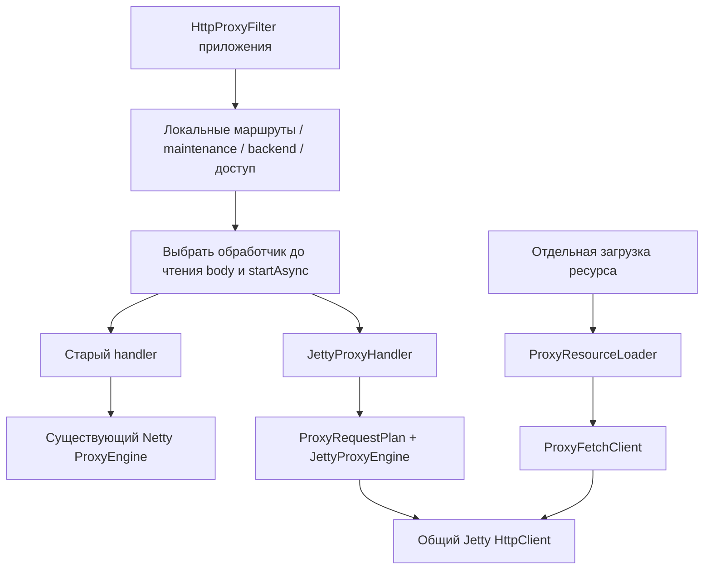

# Подключаемый Jetty proxy: реализация и проверка

Результат этапа — библиотека, которую приложение подключает обычной зависимостью.
Приватный портал недоступен; его фрагменты в `examples/proxy` использованы как
требования к API, но не объявляются собранной или перенесённой интеграцией.

## Артефакты и направление зависимостей

| Модуль | Назначение |
| --- | --- |
| `jetty-proxy` | Обычный Java 21 JAR: Servlet async proxy, bounded fetch, TLS, заголовки и body policies; без Spring/Boot/Netty |
| `jetty-proxy-spring` | Необязательный обычный JAR: явный `@Import`, binding `jetty.proxy.*`, именованные транспортные beans |
| `jetty-client-example` | Исполняемый demo, использующий библиотеки |
| `jetty-proxy-integration-example` | Независимый host с общим Filter и настоящими Jetty/Netty обработчиками |
| `jetty-proxy-integration-example/published-consumer` | Отдельная Gradle-сборка, использующая опубликованные Maven coordinates |

Существующий пакет `dev.example.jettyclient.proxy` сохранён. Библиотеки не содержат
`application.yml`, Spring Boot launcher, регистрации URL или настройки server port.
Servlet API 6.1 предоставляет принимающий контейнер. Native I/O и abort рассчитаны
на Jetty EE11 12.1.12; поддержка другого контейнера не заявлена. Jetty server classes
в transitive dependencies нужны адаптеру и сами по себе сервер не запускают.

## Граница приложения



Один запрос передаётся ровно одному обработчику. После handoff приложение не
продолжает filter chain и не повторяет body другим транспортом. Выбор в host
демонстрируется конфигурацией beans; runtime feature toggle не реализован.
`ProxyExchangeExecutor` остаётся низкоуровневым контрактом нового транспорта,
а не обязательной общей границей старого и нового прикладных сценариев.

Сессии, Security/CSRF, backend registry, permission checks, SSO/cookie storage,
кэш и ротация конфигурации принадлежат приложению. Для них доступны immutable
планы, быстрые header hooks и request/response stages с immutable patches.
Stages ожидаются в пределах общего deadline; внешняя работа выполняется на
ограниченном executor приложения. Позднее завершение stage после отмены игнорируется.

## Владение данными и расширения

- Обычный ответ передаётся потоково с backpressure и одной downstream-записью
  в полёте. Native writer удерживает исходный Jetty chunk до callback; wrappers
  используют Servlet writer и один переиспользуемый scratch. Zero-copy через
  TLS и ядро ОС не заявляется.
- Multipart POST/PUT и form body не разбираются библиотекой. Engine не вызывает
  `getParameter*`/`getParts`, не пересобирает multipart и сохраняет байты.
- `LinkRewritePolicy` переносит конкретные legacy literal/href/base/form правила.
  UTF-8 и совместимые однобайтовые кодировки сохраняют неизменённые срезы; UTF-16
  использует ограниченный строковый fallback. Это не универсальный HTML parser.
  Вход, результат, очередь workers и число сегментов ограничены.
  Если клиент запретил `identity`, его `Accept-Encoding` сохраняется и готовая
  policy пропускает преобразование; outbound compression требует отдельной
  реализации в принимающем приложении.
- `ProxyErrorPolicy` формирует локальный ответ до commit с телом до 64 КиБ.
  Запись получает отдельный бюджет `connect-timeout`; он может продлить отправку
  локальной ошибки после истечения основного exchange deadline. После commit
  возможен только abort. Preflight rejections сохраняют стандартные пустые ответы.
- `ProxyFetchClient` выполняет отдельный запрос без Servlet/loopback. Wire,
  decoded body и текст имеют отдельные пределы; gzip/deflate включаются явно.
  Fetch по умолчанию имеет собственный бюджет 8 обменов / 2 decoder threads /
  очередь 8. Он не делит semaphore streaming engine, но использует общий client.
- `ProxyCall` завершается после cleanup. Ошибка/отмена fetch может завершить
  future раньше физического cleanup; fetch admission удерживается до возврата
  ресурсов. Успешный fetch возвращает самостоятельный heap body после cleanup.
- Один immutable `ProxyTlsProfile` соответствует одному client/pool и TLS identity.
  Клиентский keystore не становится неявным truststore; без отдельного truststore
  сохраняется системное доверие. Hostname verification включена.

## Проверка

Команды выполняются из корня репозитория с JDK 21 и Gradle 8.14.3:

```bash
gradle build
bash jetty-proxy-integration-example/verify-published-consumer.sh gradle
python3 jetty-client-example/docs/build_guide.py --check
```

В облачной среде вместо `gradle` использован `/workspace/.setup/gradle`.
Consumer публикует только в локальные `build/repository`, затем проверяет
отдельно Gradle module metadata и Maven POM. Внешний registry не изменяется.

Проверки включают реальные HTTP/TLS обмены, 8 МиБ GET с SHA-256, побайтовые
multipart POST/PUT и form PUT, wrappers, raw path/query, cookies, ранние ответы,
отмену, deadline, shutdown, очереди workers, segmented rewrite и malformed HTML.
Отдельно проверяются stages до upstream I/O и commit, ошибки local writer,
wire/decode/text limits, TLS trust/hostname/mTLS identity isolation, пассивность
Spring-конфигурации и подключение обычных JAR вне multiproject-сборки.

Для runtime `65a1f9e` полная сборка успешна: **553 теста, 0 failures/errors/skips**.
Неизменённые `app`, `proxy`, `command-support` использовали Gradle UP-TO-DATE;
изменённые Jetty-модули проверены с окончательными исходниками.

| Модуль | Тесты |
| --- | ---: |
| `jetty-proxy` | 176 |
| `jetty-proxy-spring` | 4 |
| `jetty-client-example` | 104 |
| `jetty-proxy-integration-example` | 24 |
| `app` / `proxy` / `command-support` | 74 / 87 / 84 |

Независимый consumer успешно собран и выполнен как через Gradle metadata, так
и только через Maven POM. Проверены загрузка классов из обычных JAR, работа
factory/fetch, binding, явный Import, отсутствие автоматических routes/settings,
изолированные qualifiers и остановка принадлежащего Spring клиента.

Итоговые счётчики, команды, полный runtime commit и SHA-256 четырёх артефактов:
[`verification.json`](verification.json). В частности, core JAR имеет SHA-256
`748523217d7cd41fb260984db6da05a228cec81a943eb86a8d0d25674d378d7d`.
Исторические `COUNCIL_REVIEW.md`, `STRICT_REVIEW.md` и `INTEGRATION_REVIEW.md`
в demo описывают предыдущие этапы, не эту сборку.

## Практические пределы

`CONNECT`, Upgrade/WebSocket, HTTP/2, автоматические retries и Expect handshake
не реализованы. Range/сжатые/no-transform ответы проходят без преобразования;
согласование кэша и ranges преобразованной версии требует политики приложения.
Синхронный resource loader разрешён на application thread, но не Jetty callback/I/O.
Лимиты payload не являются точной границей RSS: отдельно существуют headers,
объекты, TLS, pools, worker input/output и heap-копии fetch/строк.

Исторический GET benchmark из guide сохранён как измерение предыдущего кода.
Новый прирост RPS после выделения библиотек этим этапом не заявляется.

Следующий этап — [повторный совет по сценариям и интеграции](USAGE_REVIEW.md).
Он содержит новые измерения и замечания, найденные дополнительными probes после
описанной здесь базовой проверки. Успешная сборка не означает отсутствие этих ошибок.
Замечания исправлены последующим этапом: [FIXES.md](FIXES.md), runtime `46db231`,
613 тестов. Этот файл и `verification.json` сохраняют исходную проверку `65a1f9e`.
