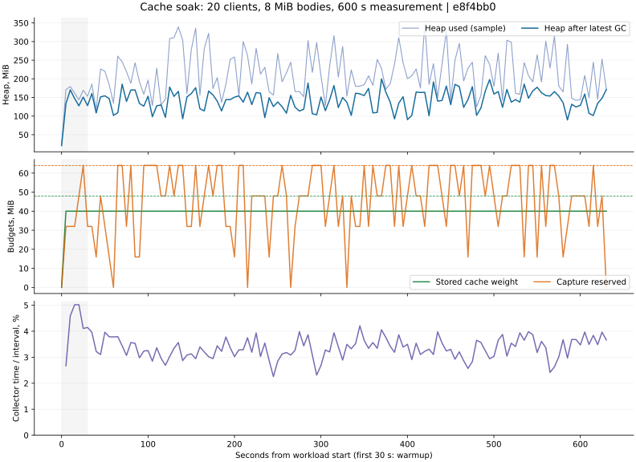

# Кэш: результат десятиминутного прогона

**PASS.** Все критерии стенда выполнены. Исходники: `e8f4bb0c04d744c1f1205b5fb592cafd569dc65f`.
Проверка выполнена 2026-10-26T11:50:36.939555261Z — 2026-10-26T12:01:11.218988845Z.

Полная сборка: **665 тестов**, 0 failures/errors/skips; host — 88, из них
52 cache-теста. Добавлены 10 детерминированных тестов publication queue и
6 HTTP end-to-end тестов. [Сценарии и SHA-256 исходников](integration-verification.json).

## Условия

Java `21.0.9+10-LTS`, 5 доступных JVM процессоров, G1,
`-Xms256m -Xmx768m`. Прогрев 30 с; измерение 600.019 с.
20 клиентов: 14 обычных, 4 медленных, 2 обрывающих передачу.
Каждый полный ответ — 8 МиБ, проверены HTTP status, raw path/query,
длина и SHA-256. Неполные ответы при намеренном обрыве учитываются отдельно.
Два горячих ключа и непрерывный поток новых ключей заставляют кэш вытеснять записи.
Вес store ограничен 48 МиБ; резерв capture — 64 МиБ; publisher — 1 worker / 4 места.

## Измеренная фаза

| Метрика | Результат |
| --- | ---: |
| Полные проверенные ответы | 64,509 |
| Полные HIT / MISS | 51,166 / 13,343 |
| Полностью прочитанные медленные ответы | 3,296 |
| Проверенные байты полных ответов | 541,140,713,472 |
| Намеренные обрывы HIT / MISS | 157,876 / 157,877 |
| Вытеснения по счётчику Guava | 8,694 |
| События GC | 7,927 |
| Время, сообщённое GC MXBeans | 20,073 мс (3.35%) |
| Максимальная длительность GC notification | 50 мс |
| Ошибки HTTP / ключа / длины / SHA-256 / публикации | 0 |

Граничные снимки concurrent-счётчиков не атомарны. Точные итоги после drain,
включающие прогрев и завершившиеся в конце запросы, находятся в
`allRequestsIncludingWarmupAndDrain` файла [report.json](report.json).

## Heap и освобождение ресурсов

| Состояние | Минимальный used heap после трёх GC |
| --- | ---: |
| Baseline после preflight и очистки | 20.59 МиБ |
| После drain, кэш ещё хранит записи | 68.93 МиБ |
| После полного закрытия и очистки | 21.36 МиБ |

Допустимый рост после drain: 48 МиБ store + 64 МиБ runtime overhead к baseline;
после close: 64 МиБ к baseline. Пороги определены до итогового запуска.
Резервы capture, активные hit/exchange, queued/active/pending publications и
ожидающие callbacks после drain равны нулю; после close также пуст store.
HTTP client, его executor и publisher завершились в заданные сроки.

Минимум heap после GC среди периодических samples в первой трети измерений:
92.76 МиБ; в последней:
89.66 МиБ. Это диагностическая характеристика
живой нагрузки; pass/fail освобождения проверяется после drain и close.
Во время прогрева и измерений принудительный GC не вызывается.

`collectorTimeRatio` не равен точной доле stop-the-world пауз. Измерен heap,
не RSS. Активные cache-hit writers могут удерживать уже вытесненные тела.

## Что подтверждено

- Первый HTTP MISS сохраняет полное тело; следующий HIT не создаёт второго
  upstream-запроса. Это отдельно проверяется HTTP-тестом и preflight стенда.
- Переполнение очереди, shutdown с активной и ожидающими задачами, поздняя
  публикация, ошибки cleanup/snapshot и гонка submit/close проверены
  детерминированными тестами. После отказов освобождаются capture reservations.
- Конкурентная нагрузка с полными и медленными чтениями, обрывами и вытеснением
  прошла 600 секунд; повреждений тел, выхода за sampled budgets и остаточных
  операций после drain нет. Итоговый retained heap удовлетворяет заданным границам.

При подготовке стенда исправлены две ошибки самого upstream на JDK 21:
блокирующие записи HttpServer на virtual threads удерживали carriers; подавление
IOException при обрыве оставляло закрытые соединения во внутреннем реестре.
Итоговый origin использует ограниченный platform pool, записи по 64 КиБ и
передаёт ошибки записи/close диспетчеру сервера. Критерии памяти не ослаблялись.

## Воспроизведение и границы

[Команда и критерии](../../README.md). Этот результат относится к указанному
commit; запуск выполнялся после фиксации исходников. Во время soak другие
Gradle/Java проверки не запускались. [Лог сборки и прогона](run.log),
[полный JSON](report.json), [CSV каждые пять секунд](samples.csv).

Proxy, origin и генератор работают в одной JVM и делят CPU. RPS этого стенда
не является production capacity или сравнением Jetty/Netty. Успешные 10 минут
не доказывают отсутствие утечек при любой длительности и любых сценариях.
Закрытый портал недоступен: проверяются реальные cache helpers и Jetty engine,
а полный старый NettyProxyRequestExecutor остаётся примером адаптации.
